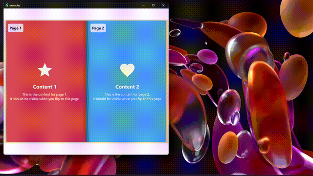

# Turnable Page: realistic page flip for Flutter

[](https://pub.dev/packages/turnable_page)
[](https://pub.dev/packages/turnable_page/score)
[](https://pub.dev/packages/turnable_page)
[](https://saeedahmed725.github.io/turnable_page/)

A **page flip / page curl widget for Flutter**. Build flipbooks, e-books, magazines, catalogs, Quran and manga readers, and **PDF page-turn viewers**, where every page is a normal, fully interactive Flutter widget.

📖 **[Read the full documentation →](https://saeedahmed725.github.io/turnable_page/)**

| Two-page spread (desktop) | Single page (mobile) | Responsive `auto` mode |
|:---:|:---:|:---:|
|  |  |  |

## Features

- **Realistic page curl**: bending paper, a white back side, and shadows on the fold, the spine and the page below.
- **Interactive pages**: buttons, text fields and scroll views inside a page keep working. Pages are live widgets, not screenshots.
- **Single, double or `auto` layout**: one page on phones, a two-page spread on tablets and desktop.
- **PDF flipbook**: open a PDF from an asset, a URL or a file with `TurnablePdf`.
- **Pinch-to-zoom** with an optional double-tap zoom.
- **RTL books** for Arabic, Hebrew, Persian and Urdu, with mirrored page turns.
- **Controller**: next, previous, animate or jump to any page, and listen to page events.
- **Large books**: only the pages near the current one are built.

## Installation

```yaml
dependencies:
  turnable_page: ^2.0.0
```

```dart
import 'package:turnable_page/turnable_page.dart';
```

## Quick start

```dart
TurnablePage(
  pageCount: 10,
  pageViewMode: PageViewMode.auto,
  builder: (context, pageIndex, constraints) {
    return ColoredBox(
      color: Colors.white,
      child: Center(child: Text('Page ${pageIndex + 1}')),
    );
  },
  onPageChanged: (leftIndex, rightIndex) {
    debugPrint('Showing $leftIndex / $rightIndex');
  },
)
```

Drag a page or tap it to turn it. The book sizes itself to fit its parent while keeping `aspectRatio`.

## Page layout: single, double or auto

| `PageViewMode` | Behavior |
|---|---|
| `single` (default) | One page at a time. |
| `double` | Two-page book spread. |
| `auto` | One page under 600 px of width, two pages from 600 px. |

Set `FlipSettings(showCover: true)` to show the first and last pages alone, like a hardcover book.

## Navigate with `PageFlipController`

```dart
final controller = PageFlipController();

TurnablePage(controller: controller, pageCount: 20, builder: buildPage);

await controller.nextPage();      // animated, completes when the turn ends
await controller.previousPage();
await controller.animateToPage(7);
controller.jumpToPage(3);         // instant

controller.currentPageIndex;      // 0-based
controller.hasNextPage;
controller.hasClients;            // true once the book is on screen
```

Every navigation method returns `false` when the page index is out of range or no book is attached. To react to events, use `controller.addEventListener(PageFlipEvent.flip, (e) => ...)`.

## Interactive pages and taps

By default, a tap on an empty part of a page turns it, and the page corners are reserved for turning. If your pages have their own tap targets (links, buttons, verses), turn that off:

```dart
TurnablePage(
  settings: FlipSettings(flipOnTap: false),
  // ...
)
```

Taps then always reach the page, and pages turn only by dragging (corners included) or from the controller. Vertical scroll views inside a page scroll normally. A mostly horizontal drag turns the page.

## Pinch-to-zoom

```dart
TurnablePage(
  enableZoom: true,
  minScale: 1.0,
  maxScale: 3.0,
  // ...
)
```

While a page is zoomed in, dragging pans the page instead of turning it. By default, a double tap zooms in and out. Set `enableDoubleTapZoom: false` to keep pinch-to-zoom and use double tap for your own gesture, such as toggling the reader UI. To reset the zoom from code, call `controller.resetZoom()`.

## PDF page flip viewer

Initialize the PDF engine once, before `runApp`:

```dart
Future<void> main() async {
  WidgetsFlutterBinding.ensureInitialized();
  await TurnablePdf.initPDFLoaders();
  runApp(const MyApp());
}
```

Then open the document:

```dart
TurnablePdf.asset('assets/catalog.pdf', pageViewMode: PageViewMode.auto);
TurnablePdf.network('https://example.com/magazine.pdf', headers: {'Authorization': token});
TurnablePdf.file('/path/to/book.pdf');
```

`TurnablePdf` accepts the same `controller`, `settings`, `onPageChanged` and `textDirection` as `TurnablePage`, plus `loadingBuilder` and `errorBuilder`. PDF rendering is provided by [pdfrx](https://pub.dev/packages/pdfrx).

## Right-to-left books

```dart
TurnablePage(
  textDirection: TextDirection.rtl, // or leave null to follow Directionality
  // ...
)
```

Page 1 is on the right and pages turn from left to right.

## Styling

**Book frame**: `paperBoundaryDecoration` takes `PaperBoundaryDecoration.vintage` (default), `.modern`, `.parchment` or `.none`, or your own `PaperBoundaryDecoration(...)`.

**Paper and shadows**:

```dart
FlipSettings(
  flippingTime: 600,                     // turn duration in ms
  pageBackgroundColor: Color(0xFF1E1E1E), // match dark pages to avoid light edges
  drawShadow: true,
  showCenterShadow: true,                 // spine shadow in a two-page spread
  centerShadowColor: Colors.black,
  innerShadowColor: Colors.black,
  outerShadowColor: Colors.black,
)
```

## API reference

### `TurnablePage`

| Parameter | Type | Default | Description |
|---|---|---|---|
| `pageCount` | `int` | required | Number of pages. |
| `builder` | `TurnableBuilder` | required | `(context, pageIndex, constraints)` → page widget. |
| `pageViewMode` | `PageViewMode?` | `single` | `single`, `double` or `auto`. |
| `controller` | `PageFlipController?` | `null` | Navigation and state. |
| `onPageChanged` | `TurnablePageCallback?` | `null` | `(leftIndex, rightIndex)`, called once each turn completes. |
| `settings` | `FlipSettings?` | `FlipSettings()` | Behavior and appearance (see below). |
| `aspectRatio` | `double?` | `2/3` per page | Width ÷ height of one page. |
| `textDirection` | `TextDirection?` | ambient | `ltr` or `rtl`. |
| `paperBoundaryDecoration` | `PaperBoundaryDecoration` | `vintage` | Frame around the book. |
| `pagesBoundaryIsEnabled` | `bool` | `true` | Show the frame. |
| `pageCacheExtent` | `int` | `4` | Pages kept built on each side of the current page. |
| `enableZoom` | `bool?` | `false` | Pinch-to-zoom. |
| `enableDoubleTapZoom` | `bool?` | `true` | Double tap toggles zoom when `enableZoom` is on. |
| `minScale` / `maxScale` | `double?` | `1.0` / `3.0` | Zoom limits. |

### `FlipSettings`

| Parameter | Default | Description |
|---|---|---|
| `startPageIndex` | `0` | First page shown. Initial value only: use the controller to navigate later. |
| `flippingTime` | `700` | Turn animation duration in ms. |
| `showCover` | `false` | Show the first and last pages alone, like covers. |
| `flipOnTap` | `true` | Tap to turn and reserve the corners for turning. Set to `false` for tappable page content. |
| `cornerTriggerAreaSize` | `0.2` | Size of the corner hot zone, as a fraction of the page diagonal. |
| `enableInertia` | `true` | A fast fling finishes the turn. |
| `enableEasing` | `true` | Eased turn animation. |
| `onlyVerticalPageFlip` | `false` | Turn pages with vertical drags only. |
| `drawShadow` | `true` | All turn shadows. |
| `showCenterShadow` | `true` | Spine shadow in a two-page spread. |
| `centerShadowColor`, `innerShadowColor`, `outerShadowColor` | `Colors.black` | Shadow colors. |
| `maxShadowOpacity` | `1.0` | Shadow strength, from 0 to 1. |
| `pageBackgroundColor` | white | Paper color behind and under pages. |

The full list, including the bend and inertia tuning values, is in the [API docs](https://pub.dev/documentation/turnable_page/latest/turnable_page/FlipSettings-class.html).

## Documentation

The [documentation website](https://saeedahmed725.github.io/turnable_page/) covers every feature in depth: gestures, events, PDF loading, styling, the full `FlipSettings` reference, recipes, migrating to 2.0, and troubleshooting.

## Example app

See [`example/`](https://github.com/saeedahmed725/turnable_page/tree/main/example) for a complete demo with all modes, PDF loading and controller usage.

## Contributing

Bug reports and feature requests are welcome on the [issue tracker](https://github.com/saeedahmed725/turnable_page/issues). Pull requests go through the official repository.

## License

Turnable Page Proprietary License (TPPL). See [LICENSE](LICENSE).
